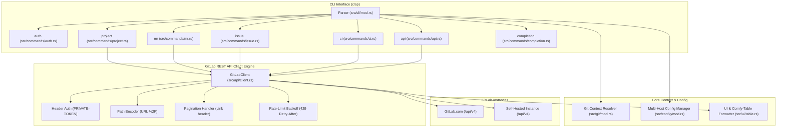

# GitLab CLI (`gitlab-cli`) — Architecture Documentation

This document describes the design, module structure, and internal mechanics of the `gitlab-cli` tool.

---

## 1. System Overview

`gitlab-cli` is a command-line interface written in Rust for interacting with GitLab instances (both GitLab.com and self-managed installations) through the GitLab REST API (`v4`).

---

## 2. Module Architecture

The codebase is organized into modular subsystems under `src/`:

### 2.1 `cli` (`src/cli/`)
Declares the CLI commands, options, and flags using `clap` derive macros:
* **`Cli`**: Root parser defining global flags (`--repo`, `--host`, `--json`, `-v/--verbose`).
* **Metadata**: Injects the repository URL (`https://github.com/GBouerat/gitlab-cli`) into `--version` (`long_version`) and `--help` (`after_help`).
* **Subcommands**:
  * `auth`: Login, status, and logout commands.
  * `project` (alias: `repo`): View project metadata, clone URLs, and list user projects.
  * `mr` (alias: `merge-request`): List, view, create, checkout, merge, close, and reopen merge requests.
  * `issue`: List, view, create, close, and reopen issues.
  * `ci` (alias: `pipeline`): List pipelines, inspect jobs, trigger pipelines, and stream live job trace logs.
  * `api`: Send arbitrary REST API requests directly to GitLab endpoints.
  * `completion`: Generate shell completions for `bash` and `zsh`.

### 2.2 `api` (`src/api/`)
Handles all network communication with the GitLab REST API:
* **`GitLabClient`**: Asynchronous HTTP client configured with a custom `User-Agent`, TLS via `rustls`, and automatic token authentication.
* **Namespaced Path Encoding**: Translates project paths (`owner/repo` or `group/subgroup/project`) into percent-encoded URL slugs (`owner%2Frepo`) as required by the GitLab REST API.
* **RFC 5988 `Link` Header Pagination**: Transparently consumes `rel="next"` links to iterate through result pages.
* **Automatic Rate Limit Backoff**: Inspects `429 Too Many Requests` responses and backs off according to the server's `Retry-After` header.
* **Job Trace Streaming**: Asynchronously streams raw execution logs from `/projects/:id/jobs/:job_id/trace` to `stdout`.

### 2.3 `config` (`src/config/`)
Provides multi-host configuration and credential management:
* **Config File**: Stored in standard XDG user config directories (`~/.config/gitlab-cli/config.toml`).
* **Multi-Instance Support**: Stores tokens for multiple instances (e.g. `gitlab.com` alongside internal enterprise domains like `gitlab.corp.example.com`).
* **Precedence Order**:
  1. CLI Flags (`--host`)
  2. Git Remote Detection (`git remote get-url origin`)
  3. Environment Variables (`GITLAB_TOKEN`, `CI_JOB_TOKEN`, `GITLAB_HOST`)
  4. Configured Host in `config.toml`
  5. Default Host (`gitlab.com`)

### 2.4 `git` (`src/git/`)
Context discovery engine:
* Inspects local Git repositories to extract active remote URLs (`origin`).
* Parses SCP-style SSH (`git@gitlab.com:owner/repo.git`), SSH protocol (`ssh://git@host:port/owner/repo.git`), and HTTPS URLs.
* Resolves currently checked out branch name for automatic source branch detection on merge requests and pipelines.

### 2.5 `models` (`src/models/`)
Strongly-typed Rust structures for GitLab REST API v4 data:
* `User`: Profiles and authors.
* `Project`: Repositories, metadata, clone URLs, and statistics.
* `MergeRequest`: Details, approval states, branches, draft flags, and conflict indicators.
* `Issue`: Issue tracker items, state, authors, and labels.
* `Pipeline` & `Job`: CI/CD pipelines, statuses, durations, and job stage breakdowns.

### 2.6 `ui` (`src/ui/`)
Terminal styling and presentation layer:
* **`comfy-table`**: Dynamic column wrapping and clean UTF-8 borders.
* **Cell Styling**: Colors and attributes (`Attribute::Bold`, `Color::Green`, `Color::Red`, `Color::Cyan`, `Color::Yellow`) are applied directly to `comfy_table::Cell` instances without raw ANSI escape strings, ensuring exact width calculations and border alignment.
* **`--json` Support**: All tabular commands support switching output to pretty-printed JSON.
* **`open_in_browser`**: Cross-platform desktop browser launcher for `--web` flags.

---

## 3. Testing Architecture

1. **Unit Tests**:
   * Remote URL parser tests (SSH, HTTPS, nested subgroups).
   * Safe table styling and status cell color verification.
   * Configuration persistence and resolution priority.
   * `ENV_LOCK` mutex to prevent race conditions during environment variable tests.
2. **Local Async HTTP Mock Tests (`wiremock`)**:
   * Mocking GitLab REST endpoints (`/api/v4/user`, `/api/v4/projects`, `/api/v4/projects/:id/merge_requests`, `/api/v4/projects/:id/pipelines`, etc.).
   * Pagination verification with RFC 5988 `Link` headers.
   * Job trace chunk streaming verification.
   * Rate limit 429 retry backoff verification.
3. **Integration CLI Tests (`assert_cmd`)**:
   * Metadata assertions on `--version` and `--help` for repository URL attribution.
   * Shell completion script validation for `bash` and `zsh`.
   * CLI alias resolution (`repo` -> `project`, `merge-request` -> `mr`, `pipeline` -> `ci`).
